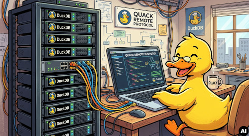

# PHP client for DuckDB Quack Remote Protocol



The Quack Remote Protocol unlocks multi-client access for DuckDB, turning DuckDB into a general-purpose database system with client(s) and server.

This library provides a pure PHP implementation for the DuckDB Quack Remote Protocol.\
It does not require FFI or C code. Only the PHP curl extension is required for the HTTP(s) connection.

This library supports all DuckDB types: Text, Numeric, Date, Time, Interval, JSON, Array, Struct, Map, List, Tuple, Type, Enum, Variant, Geometry, Union, Bitstring, Blob, and Boolean.

Supported PHP versions (nts & zts): 8.2, 8.3, 8.4, 8.5, 8.6

## Requirements

- PHP 8.2+
- curl extension

## Install and setup (client)

```bash
composer require thomas-0816/duckdb-quack-protocol-php
```

## Install and setup (server)

Install the DuckDB cli:

https://duckdb.org/docs/2.0/installation?environment=cli

Start the server:

```bash
duckdb --cmd "CALL quack_serve('quack:127.0.0.1:9494', token='secret');"
```

## Usage examples

```php
require __DIR__ . '/vendor/autoload.php';


$db = QuackClient::connect('http://127.0.0.1:9494', 'secret', 3, 10); // connect-timeout 3s, query-timeout 10s

$db->execute('CREATE TABLE table1 (id INTEGER, amount DECIMAL(10, 2), description VARCHAR)');

$db->execute('INSERT INTO table1 VALUES (?, ?, ?)', [1, 42.21, 'Hello DuckDB! 🐘 💓 🦆']);

print_r($db->fetchAll('SELECT * FROM table1'));

# Array
#     [0] => Array
#         [id] => 1
#         [amount] => 42.21
#         [description] => Hello DuckDB! 🐘 💓 🦆
```

more examples coming soon ...

## DuckDB Resources

- [Quack: Turn DuckDB into a client-server database](https://duckdb.org/quack/)
- [Quack Remote Protocol](https://duckdb.org/docs/2.0/quack/overview)

## AI Disclosure

The code is written by AI, reviewed and tested manually.

## License

MIT License
